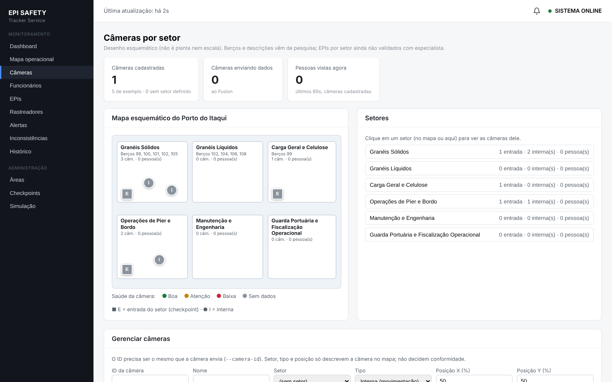
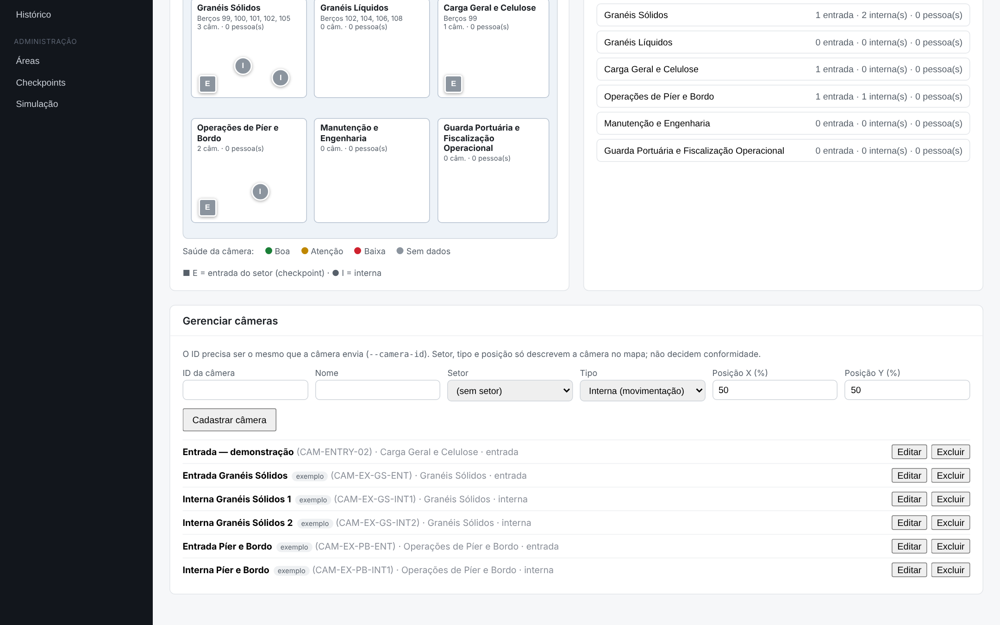
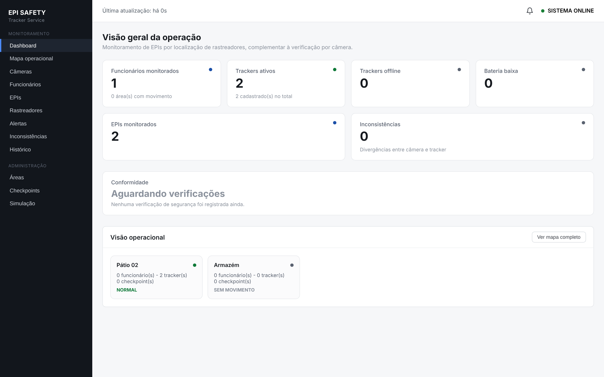

# EPI Vision — segurança de EPIs no Porto do Itaqui

Sistema que usa visão computacional (YOLO) para verificar se trabalhadores usam os EPIs
exigidos na área, abre incidentes quando há violação e mostra tudo em uma tela web.

## Princípios do projeto
- **Quem decide a conformidade é o módulo de Regras.** Câmeras, tela e rastreadores nunca decidem.
- **Não observável ≠ violação.** Se o sistema não enxerga uma parte do corpo (ex.: cabeça cortada pelo quadro), o resultado é "sem observação", nunca "ausente".
- **EPI atribuído ≠ EPI usado.**
- Sem biometria nem reconhecimento facial na interface.
- Violação só abre incidente após 3 s contínuos (evita alarme falso).

## Arquitetura (serviços independentes)
| Serviço | Porta | Função |
|---|---|---|
| `epi_ppe` | 8000 | Visão (YOLO): detecta pessoa, capacete, colete |
| `epi_identity` | 8001 | Identidade do trabalhador (simulada na demo) |
| `epi_fusion` | 8002 | Junta visão + identidade por câmera |
| `epi_rules` | 8003 | Decide a conformidade (capacete, colete, luvas, botas) |
| `epi_incident` | 8004 | Abre e resolve incidentes |
| `epi_alerts` | 8005 | Alertas |
| `epi_tracker` | 8010 | Mapa, setores, câmeras e rastreadores (API) |
| `epi_tracker/frontend` | 8020 | Tela em React |
| `epi_integration` | — | Pipeline da câmera e scripts de demo |

## Cadastro de câmeras por setor (etapa mais recente)
Na tela **Câmeras → Gerenciar câmeras** dá para cadastrar, editar e excluir câmeras
(ID, nome, setor, tipo entrada/interna, posição no mapa). O cadastro é salvo em
`~/.epi_vision/cameras.json` e sobrevive a reiniciar. Setor e posição só localizam a
câmera no mapa; **não alteram a conformidade**. API: `GET/POST /api/v1/cameras`,
`GET/PUT/DELETE /api/v1/cameras/{id}`.

## Prints da plataforma




## Como rodar (Python 3.12)
```bash
python -m venv .venv && source .venv/bin/activate
pip install fastapi "uvicorn[standard]" pydantic pydantic-settings httpx pyjwt \
            sqlalchemy aiosqlite greenlet cryptography numpy
```
**Modo simulado (sem modelo e sem webcam):**
```bash
cd epi_integration && python scripts/start_demo.py --mock      # terminal 1
cd epi_tracker/frontend && python3 -m http.server 8020        # terminal 2
```
Abra http://127.0.0.1:8020/index.html#cameras

**Com webcam e modelo YOLO:** veja `epi_integration/docs/GUIA_DEMO_WEBCAM.md`.
O modelo (`best.pt`) não está no repositório; veja [docs/MODELO.md](docs/MODELO.md).

## Testes
```bash
cd epi_tracker && python -m pytest tests -q      # idem em epi_fusion e epi_integration
```

## Estado e próximos passos
- Detecta capacete e colete (inclusive colete azul). Luvas e botas estão nas regras e testadas;
  falta retreinar o modelo para reconhecê-las.
- Identidade ainda é simulada; integração com Spring Boot descrita em
  `epi_integration/docs/integracao_spring_boot.md`.
- Decisão em aberto: o cadastro oficial de câmeras ficará no Tracker ou no Spring.

## Créditos dos dados de treino
- Ultralytics Construction-PPE (CC BY 4.0)
- Dataset de coletes (autor "college", CC BY 4.0)
